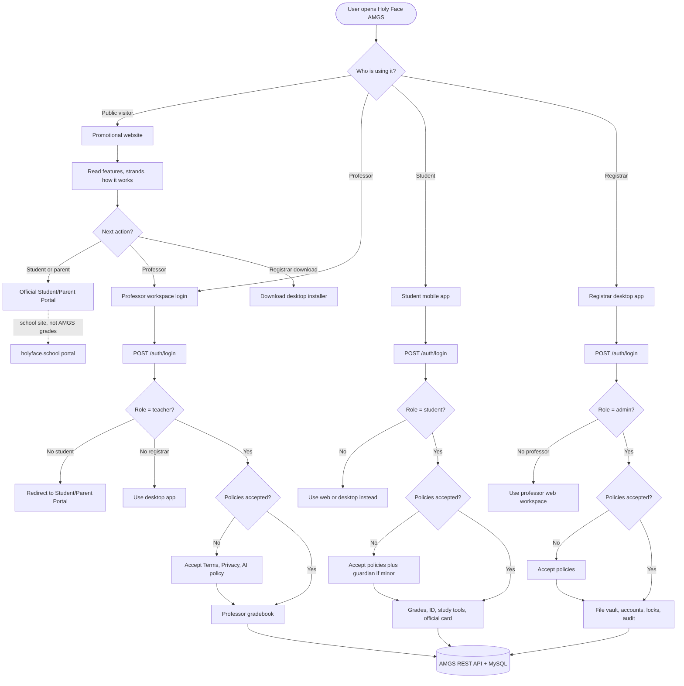
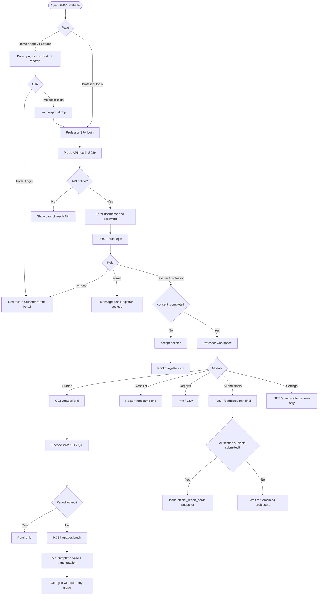
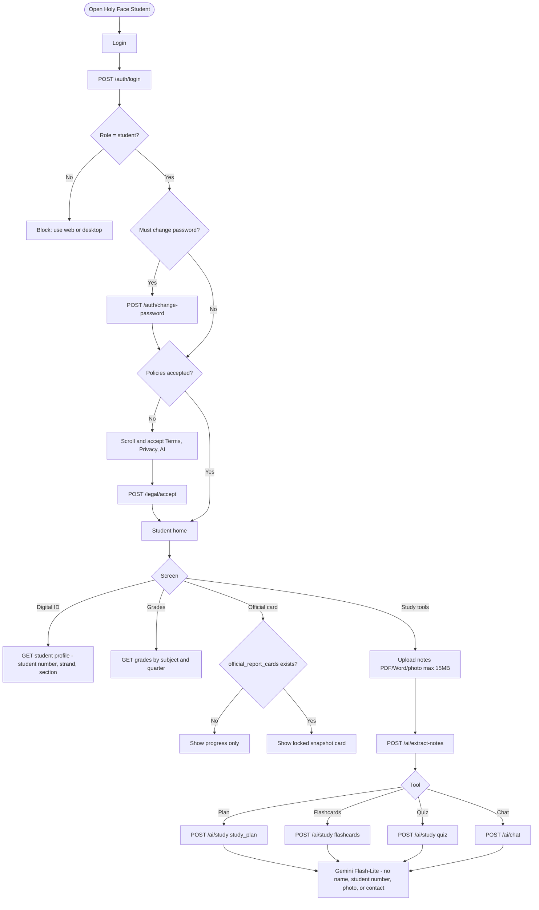
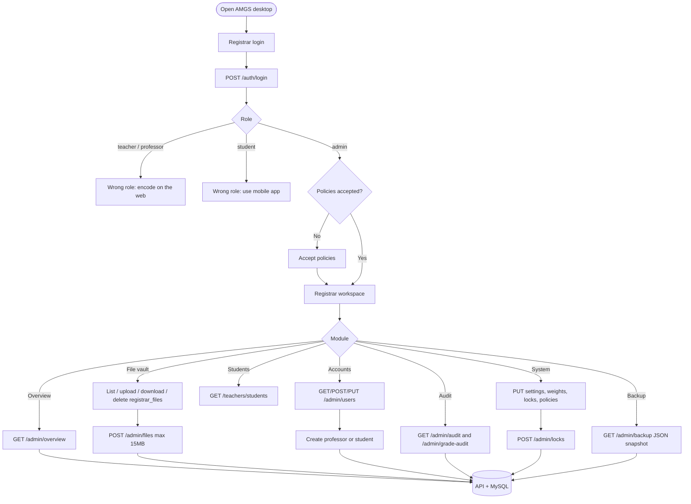
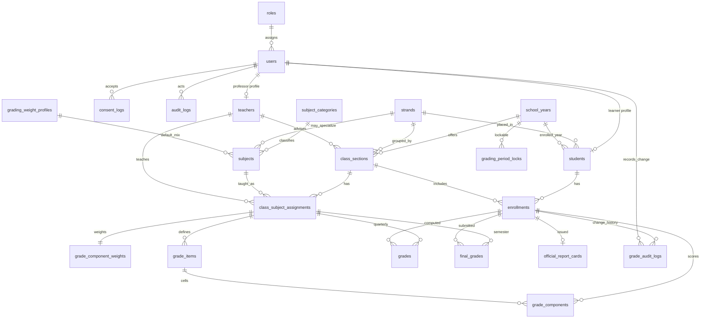
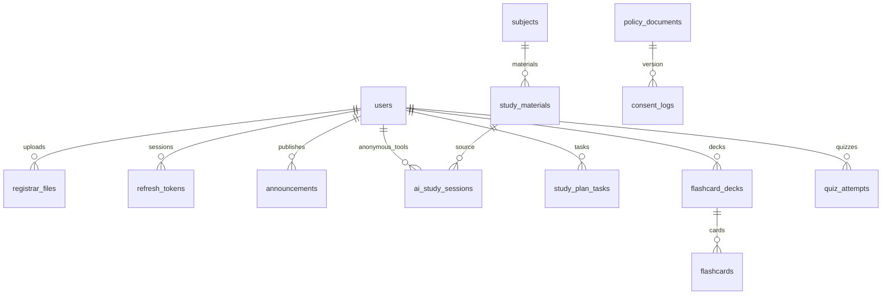
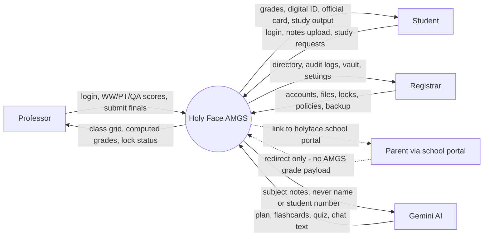
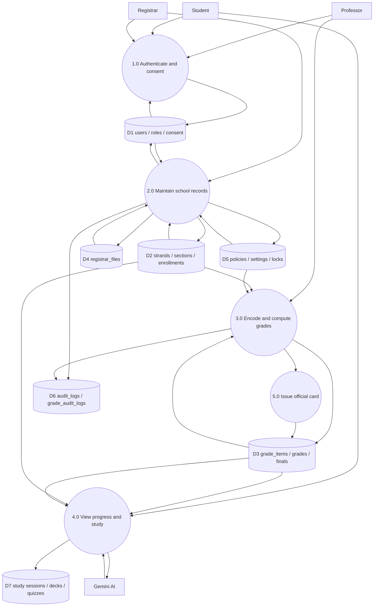
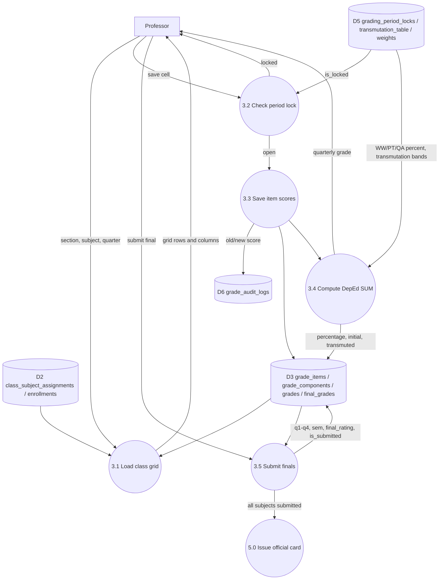

# Holy Face AMGS — Flowcharts, ERD, and DFD

**HTML (open in a browser, then Print → PDF):** [amgs-diagrams.html](amgs-diagrams.html) or `http://127.0.0.1:8090/diagrams.html` while the web server is running. Includes simple IPO (Input–Process–Output) for the whole system, web, mobile, and desktop.

Source of truth: the running system (PHP API + MySQL `holyface_amgs`, professor web workspace, student mobile app, registrar desktop). Roles in the database remain `admin` / `teacher` / `student`; user-facing labels are **Registrar**, **Professor**, and **Student**.

---

## 1. Overall system flowchart



---

## 2. Web flowchart (public site + professor workspace)



---

## 3. Mobile flowchart (student app)



---

## 4. Desktop flowchart (registrar console)



---

## 5. Entity-relationship diagram (core academic)

Logical ERD of tables used for enrollment and DepEd grading. `students.lrn` is shown to users as **student number**.



### Supporting stores



---

## 6. DFD Level 0 — context



---

## 7. DFD Level 1 — major processes



---

## 8. DFD Level 2 — process 3.0 Encode and compute grades



**3.4 computation (DepEd Order No. 8, s. 2015)** stored in DB, not hard-coded only:

1. Percentage Score = (total score ÷ total HPS) × 100 (SUM; absent/excused skipped)
2. Weighted Score = Percentage Score × component weight
3. Initial Grade = WW + PT + QA weighted
4. Quarterly Grade = transmutation table lookup
5. Final Grade = average of semester quarters, rounded
6. Official card = snapshot when every assigned subject has submitted finals
```
